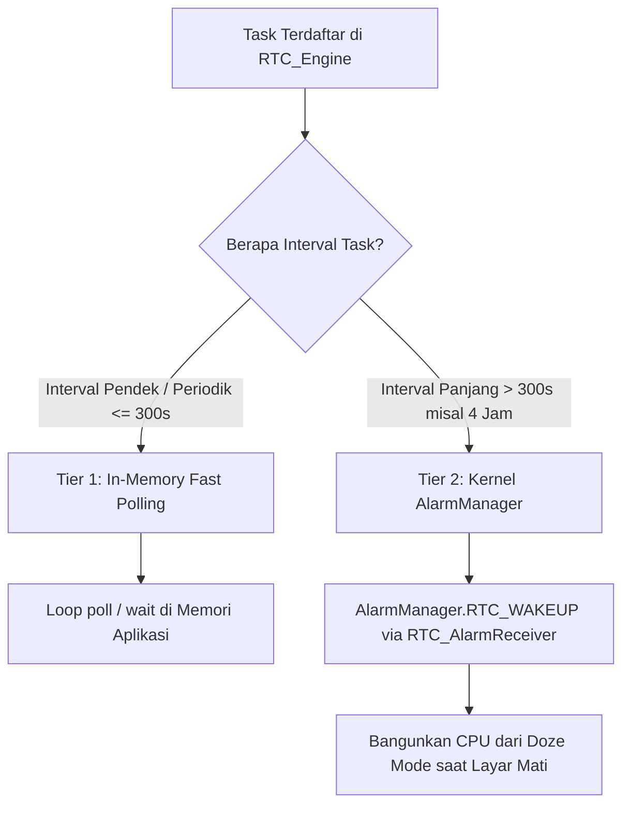

# 📚 Transfer Knowledge: Arsitektur, Concurrency, & RTOS Core pada ADA 3.0

Dokumen ini adalah panduan referensi arsitektural komprehensif yang membedah seluruh pustaka (*libraries*), struktur data *concurrent*, kelas sistem operasi Android, konvensi penamaan ketat, serta mekanisme penjadwalan *Two-Tier RTOS* yang diimplementasikan pada **ADA 3.0 (Prototype RTOS Core)**.

---

## 📑 Daftar Isi
1. [Prinsip Desain & Konvensi Inti (KISS & Clean Core Conventions)](#1-prinsip-desain--konvensi-inti-kiss--clean-core-conventions)
2. [ConcurrentHashMap<K, V>](#2-concurrenthashmapk-v)
3. [@Volatile & Memory Barrier](#3-volatile--memory-barrier)
4. [Mekanisme Dynamic Thread Priority Switching](#4-mekanisme-dynamic-thread-priority-switching)
5. [ProcessHandle (PID) & Thread Tracking](#5-processhandle-pid--thread-tracking)
6. [Mekanisme Penjadwalan Dua Tingkat (Two-Tier Timing System)](#6-mekanisme-penjadwalan-dua-tingkat-two-tier-timing-system)
7. [RTOS Numeric Priority: "Angka Lebih Rendah Lebih Didahulukan"](#7-rtos-numeric-priority-angka-lebih-rendah-lebih-didahulukan)
8. [Pencegahan Cumulative Timer Drift & Task Starvation](#8-pencegahan-cumulative-timer-drift--task-starvation)
9. [SingleThreadExecutor & Worker Pool untuk Heavy I/O](#9-singlethreadexecutor--worker-pool-untuk-heavy-io)
10. [AlarmManager.RTC_WAKEUP & setExactAndAllowWhileIdle](#10-alarmmanagerrtc_wakeup--setexactandallowwhileidle)
11. [PendingIntent (Otorisasi IPC Lintas Proses)](#11-pendingintent-otorisasi-ipc-lintas-proses)
12. [Komponen Konkurensi Tambahan (Background Worker & Service)](#12-komponen-konkurensi-tambahan-background-worker--service)
13. [📊 Tabel Ringkasan Komponen & Dampak Arsitektur](#13--tabel-ringkasan-komponen--dampak-arsitektur)

---

## 1. Prinsip Desain & Konvensi Inti (KISS & Clean Core Conventions)

Seluruh komponen pada package `com.example.core` tunduk pada aturan ketat berikut:

### A. 1 Class = 1 File
Setiap file `.kt` hanya boleh mendeklarasikan satu class utama atau satu data model:
- `RTC_Engine.kt` $\rightarrow$ façade scheduler engine publik.
- `RTC_Task.kt` $\rightarrow$ data model task, metadata PID/Priority, dan runner.
- `RTC_AlarmReceiver.kt` $\rightarrow$ pemicu broadcast dari kernel Android.
- `NAV_AisCollector.kt` & `NAV_AisDataModel.kt` $\rightarrow$ modul telemetri navigasi.

### B. Prefix Modul Berdasarkan Fungsi
- **`RTC_`** : Real-Time Clock / Timer / Scheduler (`RTC_Engine`, `RTC_Task`, `RTC_AlarmReceiver`).
- **`NAV_`** : Navigation / Sensor / AIS (`NAV_AisDataModel`, `NAV_AisCollector`).
- **`FS_`**  : Foreground Service / Background Runner.
- **`DB_`**  : Database / Cache Storage.
- **`NET_`** : Network / API / Telemetry Sync.

### C. Aturan Visibilitas & Underscore Ketat
- **`private` (Double Underscore `__`):** Variabel atau fungsi internal privat yang dilarang bocor keluar class (`private var __running`, `private val __tasks`, `private val __actions`).
- **`internal` / `protected` (Single Underscore `_`):** Variabel/fungsi antar class dalam modul (`internal var _activeInstance`, `internal fun _handleAlarmTick`).
- **`public` (Tanpa Underscore):** API publik yang diekspos keluar (`fun register(...)`, `fun poll()`, `fun wait()`, `fun dump()`, `fun stop()`).

---

## 2. `ConcurrentHashMap<K, V>`

* **Paket:** `java.util.concurrent.ConcurrentHashMap`
* **Lokasi Penggunaan:** 
  - `RTC_Engine.kt` (`private val __tasks = ConcurrentHashMap<String, RTC_Task>()`)
  - `RTC_Engine.kt` (`private val __actions = ConcurrentHashMap<String, (String) -> Unit>()`)

### Mengapa Bukan `HashMap` Biasa?
`HashMap` standar di Java/Kotlin **TIDAK Thread-Safe**. Pada sistem navigasi dan penjadwalan multi-thread:
1. Jika thread loop `poll()` sedang membaca daftar task sementara thread alarm atau UI mendaftarkan task baru lewat `register()`, `HashMap` biasa akan melempar crash fatal `ConcurrentModificationException`.
2. Pada sistem multi-core, modifikasi simultan pada `HashMap` biasa dapat merusak struktur pointer internal (*hash bucket*), memicu *infinite loop* yang mengunci CPU hingga 100%.

### Cara Kerja di Balik Layar:
`ConcurrentHashMap` menggunakan teknik **Bucket-Level Locking (CAS - Compare-And-Swap)**:
- **Lock-Free Read:** Operasi pembacaan (`get`, iterasi `.values`) berjalan tanpa penguncian (lock-free) sehingga ribuan pembacaan status per detik tidak pernah tertahan.
- **Segmented/Bucket Write:** Penguncian hanya terjadi pada satu ember (*bucket*) memori yang sedang ditulis, tanpa memblokir pembacaan task lainnya.

---

## 3. `@Volatile` & Memory Barrier

* **Anotasi:** `kotlin.jvm.Volatile`
* **Lokasi Penggunaan:**
  - `RTC_Engine.kt` (`@Volatile private var __running = false`)
  - `RTC_Engine.kt` (`@Volatile internal var _activeInstance: RTC_Engine? = null`)

### Mengapa Ini Diperlukan?
Setiap core CPU modern memiliki memori cache lokal kecepatan tinggi (**L1/L2 Cache**):
- Tanpa `@Volatile`, saat Thread A (misal Main Thread) mengubah `__running = false`, nilai tersebut sering kali hanya tersimpan di cache Core A dan **belum langsung dibuang ke RAM fisik**.
- Akibatnya, Thread B yang sedang menjalankan loop `while (__running)` di Core B akan terus membaca nilai `true` dari cache-nya sendiri, menyebabkan loop tidak pernah berhenti (*ghost state*).

### Solusi `@Volatile`:
Anotasi ini memerintahkan kompilator dan CPU untuk memasang **Memory Barrier / CPU Fence**:
1. Setiap penulisan variabel langsung dipaksa tembus ke RAM utama.
2. Setiap pembacaan variabel diwajibkan membaca langsung dari RAM utama, melewati cache CPU.
3. Menjamin visibilitas instan antar-thread secara presisi.

---

## 4. Mekanisme Dynamic Thread Priority Switching

* **Lokasi Penggunaan:** `RTC_Task.kt` (`fun execute(...)`)

### Cara Kerja:
```kotlin
fun execute(action: ((String) -> Unit)? = null) {
    val originalPriority = Thread.currentThread().priority
    // 1. Naikkan priority thread sesuai kebutuhan task
    Thread.currentThread().priority = toThreadPriority()
    try {
        action?.invoke(taskId)
    } finally {
        // 2. Wajib kembalikan priority ke semula dalam blok finally
        Thread.currentThread().priority = originalPriority
        status = if (periodicFlag) STATUS_WAITING else STATUS_DONE
    }
}
```

### Mengapa Dinamis di Dalam `try-finally`?
1. **Efisiensi Thread:** Alih-alih membuat banyak thread berbeda untuk tiap level priority (yang memboroskan memori stack ~1MB per thread), kita menggunakan satu thread kerja yang prioritasnya dinaikkan secara dinamis saat mengeksekusi task darurat/real-time (`Priority 1`), lalu segera dipulihkan setelah selesai.
2. **Jaminan `finally`:** Jika task mengalami *exception* atau error di tengah jalan, prioritas thread **dijamin 100% kembali normal** dan tidak mencemari eksekusi task berikutnya.

---

## 5. `ProcessHandle` (PID) & Thread Tracking

* **Lokasi Penggunaan:** `RTC_Task.kt` (`pid = ProcessHandle.current().pid()`, `threadId = Thread.currentThread().threadId()`)

### Kegunaan dalam Sistem RTOS / Telemetri:
- **`PID` (Process ID):** Mengetahui nomor identitas proses tingkat OS yang sedang memegang task. Sangat krusial untuk logging di terminal, pemantauan konsumsi memori Linux/Android, dan analisis apakah task berjalan di proses utama atau sub-proses.
- **`threadId` (Thread ID):** Melacak identitas thread JVM yang melayani task, memudahkan identifikasi jika terjadi *deadlock* atau *race condition*.

---

## 6. Mekanisme Penjadwalan Dua Tingkat (Two-Tier Timing System)

Sistem ADA 3.0 memisahkan penanganan waktu menjadi dua lapisan cerdas:



### 1. Tier 1: In-Memory Fast Polling (`poll()` & `wait()`)
- Digunakan untuk task real-time seperti pembacaan AIS GPS (1 detik) atau update UI (5 detik).
- **`poll()`**: Non-blocking. Mengambil seluruh task periodik yang jadwalnya $\le$ waktu sekarang (`now`), mengeksekusi sesuai urutan prioritas, lalu memajukan jadwal.
- **`wait(maxWaitMs)`**: Cerdas menghitung selisih waktu terdekat (`sleepMs = minOf(nextRunEpoch) - now`). Thread hanya tidur selama waktu yang dibutuhkan tanpa membuang siklus CPU (0% CPU saat menunggu).

### 2. Tier 2: Kernel Hardware Alarm (`AlarmManager`)
- Digunakan untuk task interval panjang seperti sinkronisasi telemetri 4 jam (`SYNC_BATCH_4H` = 14.400 detik).
- Jika kita menggunakan loop in-memory biasa untuk 4 jam, Android akan membunuh proses aplikasi untuk menghemat baterai (*Doze Mode*).
- Dengan mendaftarkan ke `AlarmManager`, CPU perangkat diizinkan tidur pulas. Chip RTC hardware Android yang akan membangunkan aplikasi saat waktu 4 jam tiba.

---

## 7. RTOS Numeric Priority: "Angka Lebih Rendah Lebih Didahulukan"

* **Lokasi Penggunaan:** `RTC_Task.kt`, `RTC_Engine.kt`

Pada ADA 3.0, konvensi prioritas diselaraskan dengan standar industri RTOS (FreeRTOS / Linux Real-Time):

$$\mathbf{Priority\ 1\ (Tertinggi)} > \mathbf{Priority\ 2\ (Normal)} > \mathbf{Priority\ 3\ (Rendah)}$$

### Aturan Konversi Otomatis (`autoPriority`):
```kotlin
fun autoPriority(timerSec: Long): Int = when {
    timerSec <= 5   -> 1  // Real-Time / Sensor Kritis (Didahulukan)
    timerSec <= 300 -> 2  // Normal (UI / Log rutin)
    else            -> 3  // Rendah / Background (Batch sync panjang)
}
```

### Pemetaan ke Prioritas Thread JVM:
| RTOS Priority (Angka) | Kategori | JVM Thread Priority | Status di Sistem |
| :---: | :--- | :---: | :--- |
| **`1`** | Real-Time / Fast Sensor | `Thread.MAX_PRIORITY` (10) | Paling didahulukan saat jatuh tempo |
| **`2`** | Normal Periodic Task | `Thread.NORM_PRIORITY` (5) | Dijalankan setelah Priority 1 |
| **`3`** | Low / Long-Interval Batch | `Thread.MIN_PRIORITY + 1` (2) | Dijalankan paling akhir |

---

## 8. Pencegahan Cumulative Timer Drift & Task Starvation

### A. Pencegahan Cumulative Drift (Penyimpangan Jam)
Jika penjadwalan periodik menggunakan perhitungan:
$$\text{nextRunEpoch} = \text{System.currentTimeMillis()} + (\text{timerSec} \times 1000)$$
Setiap keterlambatan pemrosesan sekian milidetik akan terakumulasi, menyebabkan jam sistem kapal meleset puluhan detik setiap jam.

**Solusi pada ADA 3.0:**
```kotlin
if (periodicFlag) {
    nextRunEpoch += (timerSec * 1000L) // Menjaga grid interval tetap absolut
}
```
Jadwal berikutnya dihitung dari target waktu sebelumnya, bukan dari jam saat task selesai, sehingga interval waktu tetap presisi (*Fixed-Rate Scheduling*).

### B. Pencegahan Task Starvation (Kelaparan Task)
- Dalam 1 kali pemanggilan `poll()`, sistem mengambil **seluruh task yang jatuh tempo**, mengurutkannya dengan `.sortedBy { it.priority }`, dan mengeksekusinya.
- Begitu task Priority 1 selesai, jadwalnya langsung dimajukan ke interval berikutnya. Task Priority 1 **tidak dapat memotong antrean lagi** pada siklus tersebut, sehingga task Priority 2 dan 3 dijamin tetap mendapatkan giliran dieksekusi.

---

## 9. `SingleThreadExecutor` & Worker Pool untuk Heavy I/O

* **Paket:** `java.util.concurrent.Executors`
* **Lokasi Penggunaan:** `main.kt` (`ut2()`), Background Data Syncer

### Aturan Emas RTOS:
> **Callback `action` pada `RTC_Engine` WAJIB Non-Blocking (< 5 milidetik).**

Jika task perlu melakukan penulisan database SQLite, pembacaan disk besar, atau HTTP/Satelit Sync:
```kotlin
rtc.register(taskId = "BATCH_SYNC", timerSec = 3L, periodicFlag = false) { taskId ->
    // Callback RTC selesai dalam 0.1ms
    batchPool.execute {
        // Proses berat I/O berjalan di thread pool latar belakang
        kirimDataTelemetriKeServer()
    }
}
```
Dengan pola ini, loop utama `RTC_Engine` tetap responsif dan tidak ada task lain yang terhambat.

---

## 10. `AlarmManager.RTC_WAKEUP` & `setExactAndAllowWhileIdle`

* **Paket:** `android.app.AlarmManager`
* **Lokasi Penggunaan:** `RTC_AlarmReceiver.kt` (`schedule(...)`)

### Mengapa Ini Perintah Paling Kritis di Android?
Android memiliki fitur penghemat daya agresif bernama **Doze Mode**. Saat tablet navigasi kapal layarnya mati dan tidak disentuh:
- Thread biasa akan dibekukan oleh OS.
- Timer memori dan coroutine berhenti berdetak.

`setExactAndAllowWhileIdle` dengan flag `AlarmManager.RTC_WAKEUP`:
- Berkomunikasi langsung ke **Chipset Real-Time Clock (RTC) Hardware** perangkat.
- Mengirimkan sinyal *hardware interrupt* untuk membangunkan prosesor CPU tepat pada milidetik yang ditentukan, bahkan saat Android berada di level tidur terdalam (*Deep Sleep*).

---

## 11. `PendingIntent` (Otorisasi IPC Lintas Proses)

* **Paket:** `android.app.PendingIntent`
* **Lokasi Penggunaan:** `RTC_AlarmReceiver.kt` (`PendingIntent.getBroadcast(...)`)

### Konsep di Balik Layar:
`PendingIntent` adalah **Token Surat Kuasa Antar-Proses (IPC - Inter-Process Communication)**:
1. Ketika alarm didaftarkan ke `AlarmManager`, yang memegang kendali alarm adalah proses inti sistem operasi Android (`system_server`), **bukan** proses aplikasi kita.
2. Proses `system_server` tidak memiliki hak akses langsung ke memori aplikasi kita.
3. Melalui `PendingIntent`, aplikasi memberikan mandat resmi:
   > *"Wahai OS Android, simpan token ini. Saat jam alarm tiba, gunakan token ini untuk memanggil `RTC_AlarmReceiver` atas nama aplikasi saya."*
4. Flag `FLAG_UPDATE_CURRENT` atau `FLAG_IMMUTABLE` memastikan keamanan token dan pembaruan parameter tanpa duplikasi intent di sistem.

---

## 12. Komponen Konkurensi Tambahan (Background Worker & Service)

Komponen-komponen berikut adalah fondasi yang siap digunakan saat mengintegrasikan `RTC_Engine` dengan Android Service penuh (`FS_ForegroundService`):

| Komponen | Paket | Peran & Cara Kerja |
| :--- | :--- | :--- |
| **`LinkedBlockingQueue<E>`** | `java.util.concurrent` | Antrean thread-safe dengan kemampuan **Blocking Sleep** (`take()`). Menidurkan worker thread hingga 0% CPU saat antrean kosong dan langsung membangunkannya saat data masuk (`offer()`). |
| **`CopyOnWriteArrayList<E>`** | `java.util.concurrent` | List thread-safe untuk skenario *banyak pembaca, jarang menulis*. Mencegah crash saat subscriber diiterasi setiap detik sementara ada pendaftaran listener baru. |
| **`AtomicLong`** | `java.util.concurrent.atomic` | Counter nomor urut detak (`seq`) berbasis instruksi CPU hardware **CAS (Compare-And-Swap)** tanpa lock lambat. |
| **`PowerManager.WakeLock`** | `android.os` | Memegang `PARTIAL_WAKE_LOCK` pada Linux Kernel agar CPU Android tetap hidup 100% membaca sensor kapal meski layar fisik dimatikan. |

---

## 13. 📊 Tabel Ringkasan Komponen & Dampak Arsitektur

| Komponen / Fitur | Masalah yang Dipecahkan | Dampak Fatal jika Menggunakan Cara Biasa |
| :--- | :--- | :--- |
| **`ConcurrentHashMap`** | Akses tabel task bersamaan oleh thread poll & alarm | Crash aplikasi (`ConcurrentModificationException`) atau CPU 100% loop |
| **`@Volatile`** | Sinkronisasi status flag (`__running`, `_activeInstance`) antar core CPU | Thread membaca status basi dari cache CPU; loop tidak mau berhenti |
| **`Numeric Priority (1, 2, 3)`** | Standar urutan eksekusi RTOS (angka rendah = prioritas tinggi) | Task kritis (sensor haluan kapal) tersalip oleh task log biasa |
| **`Dynamic Priority Switching`** | Prioritas thread dinaikkan sementara di blok `try-finally` | Pemborosan memori jika membuat banyak thread untuk tiap priority |
| **`Fixed-Rate Rescheduling`** | Menghitung `nextRunEpoch += timerSec * 1000L` | Jam navigasi kapal mengalami *cumulative drift* (meleset puluhan detik) |
| **`ProcessHandle (PID)`** | Identifikasi nomor proses sistem operasi aktual | Monitoring proses dan deteksi multi-proses OS tidak dapat dilakukan |
| **`Two-Tier Scheduler`** | Memadukan loop in-memory (1s) & AlarmManager (4 jam) | Baterai boros jika alarm dipakai tiap detik; task 4 jam mati jika pakai loop memori |
| **`AlarmManager.RTC_WAKEUP`** | Menjalankan jadwal telemetri 4 jam saat perangkat tertidur | Laporan periodik mati total saat kapal berlayar malam hari (layar mati) |
| **`PendingIntent`** | Memberi mandat ke OS Android untuk membangunkan receiver | OS Android tidak bisa memicu kode aplikasi saat aplikasi tertidur |
